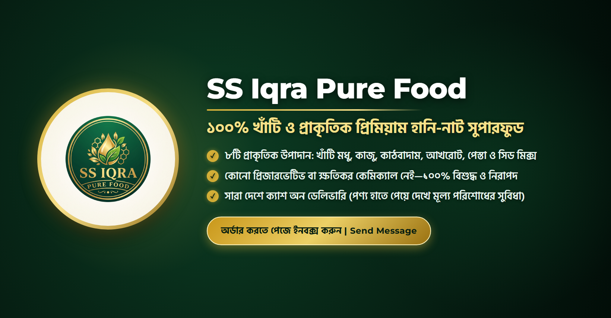
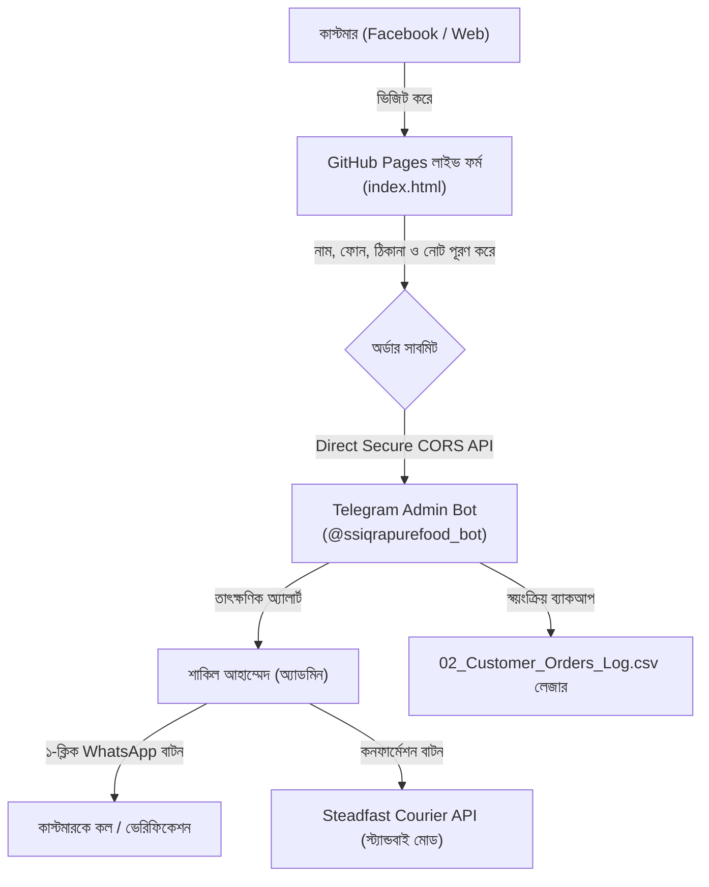

# SS Iqra Pure Food (এস এস ইকরা পিওর ফুড)
### *প্রিমিয়াম কোয়ালিটি হানি-নাট ও সম্পূর্ণ অটোমেটেড ই-কমার্স অপারেশনাল সিস্টেম*

<div align="center">



[](https://sakilahammed-dev.github.io/ss-iqra-pure-food/)
[](https://t.me/ssiqrapurefood_bot)
[](https://python.org)
[](LICENSE)

**লাইভ অর্ডার ফর্ম:** [https://sakilahammed-dev.github.io/ss-iqra-pure-food/](https://sakilahammed-dev.github.io/ss-iqra-pure-food/)

</div>

---

## ১. ওভারভিউ (Overview)
**SS Iqra Pure Food (এস এস ইকরা পিওর ফুড)** হলো খাঁটি, প্রাকৃতিক ও স্বাস্থ্যসম্মত খাবারের বিশ্বস্ত ব্র্যান্ড। আমাদের ফ্ল্যাগশিপ পণ্য হলো **১ কেজি মেগা ফ্যামিলি জার প্রিমিয়াম হানি-নাট (Honey-Nut)**—যা সুন্দরবনের খাঁটি মধু এবং প্রিমিয়াম কোয়ালিটির ড্রাই ফ্রুটস ও বাদামের সমন্বয়ে তৈরি।

এই রিপোজিটরিতে সম্পূর্ণ ব্যবসার:
1. **লাইভ ফ্রন্টএন্ড ওয়েব অর্ডার পোর্টাল** (GitHub Pages-এ সম্পূর্ণ ফ্রি ও আজীবন স্থায়ী হোস্টিং)
2. **টেলিগ্রাম বট ও ইনস্ট্যান্ট নোটিফিকেশন ইঞ্জিন** (প্রতিটি অর্ডার রিয়েল-টাইমে অ্যাডমিনের মোবাইলে পৌঁছায়)
3. **কাস্টমার ডেটাবেজ ও স্বয়ংক্রিয় একাউন্টিং লেজার** (`02_Customer_Orders_Log.csv`)
4. **অফিসিয়াল ব্র্যান্ড অ্যাসেটস ও সোশ্যাল মিডিয়া টেমপ্লেট**
5. **বিজনেস ম্যানুয়াল, সেলস স্ক্রিপ্ট ও ১ মাসের সম্পূর্ণ কন্টেন্ট ক্যালেন্ডার** অন্তর্ভুক্ত রয়েছে।

---

## ২. সিস্টেম আর্কিটেকচার (System Architecture)



---

## ৩. মূল বৈশিষ্ট্যসমূহ (Core Features)

### ক. ইনস্ট্যান্ট জিরো-ল্যাটেন্সি ওয়েব চেকআউট (`index.html`)
- সম্পূর্ণ রেসপনসিভ ও মোবাইল-ফ্রেন্ডলি ডিজাইন (মোবাইল ব্রাউজারে ৩ সেকেন্ডের কম সময়ে লোড হয়)।
- কাস্টমারকে কোনো অ্যাকাউন্ট খোলা ছাড়াই সরাসরি নাম, মোবাইল নম্বর ও ঠিকানা দিয়ে ক্যাশ অন ডেলিভারিতে অর্ডার করার সুবিধা।
- ঢাকার ভিতরে (৳৮০) এবং ঢাকার বাইরে (৳১৫০) হোম ডেলিভারি চার্জ স্বয়ংক্রিয়ভাবে ক্যালকুলেশন।
- অর্ডার সফল হলে গ্রাহককে তাৎক্ষণিক ডিজিটাল ইনভয়েস স্লিপ প্রদর্শন।

### খ. টেলিগ্রাম অর্ডার ম্যানেজার ইঞ্জিন (`telegram_order_manager.py`)
- ব্যাকগ্রাউন্ড ডেমন লিসেনার হিসেবে সার্ভার বা লোকাল পিসিতে ২৪/৭ চলে।
- নতুন অর্ডার আসলে অ্যাডমিনের মোবাইলে সাউন্ড সহকারে সম্পূর্ণ ডিটেইলস (নাম, নম্বর, ঠিকানা, পণ্য, মোট বিল) পুশ নোটিফিকেশন পাঠায়।
- **ইন্টারেক্টিভ অ্যাকশন বাটন:**
  - `WhatsApp-এ চ্যাট করুন`: গ্রাহকের নম্বরে এক ক্লিকেই সরাসরি WhatsApp চ্যাট ওপেন হয়।
  - `Steadfast বুকিং স্লিপ`: কুরিয়ার পার্সেল বুকিংয়ের জন্য প্রয়োজনীয় ডাটা তৈরি করে দেয়।
  - `অর্ডার কনফার্মড`: অর্ডারটি নিশ্চিত করে কাস্টমার লেজারে স্ট্যাটাস আপডেট করে।

### গ. স্বয়ংক্রিয় একাউন্টিং ও অর্ডার হিস্ট্রি (`02_Customer_Orders_Log.csv`)
- প্রতিটি অর্ডারের ইনভয়েস আইডি, তারিখ, কাস্টমার তথ্য, ডেলিভারি চার্জ এবং অর্ডার স্ট্যাটাস নির্ভুলভাবে রেকর্ড থাকে।

---

## ৪. ফাইল ও ডিরেক্টরি পরিচিতি (Directory Structure)

```plaintext
├── index.html                           # লাইভ ওয়েব অর্ডার ফর্ম (GitHub Pages রুট)
├── telegram_order_manager.py            # টেলিগ্রাম বট ও ব্যাকগ্রাউন্ড অর্ডার প্রসেসর
├── 01_Live_Products_and_Prices.csv      # পণ্যের নাম, ওজন, রেগুলার ও অফার মূল্যের তালিকা
├── 02_Customer_Orders_Log.csv           # সফল অর্ডারসমূহের একাউন্টিং ও কাস্টমার লেজার
├── SS_IQRA_MASTER_PASSPORT.md           # মাস্টার এক্সেস পাসপোর্ট, লিংক ও এপিআই নির্দেশিকা
├── google_apps_script_ledger.js         # গুগল শিট ইন্টিগ্রেশনের জন্য অ্যাপস স্ক্রিপ্ট কোড
│
├── docs/                                # প্রফেশনাল বিজনেস ও অপারেশনাল ম্যানুয়াল
│   ├── 1_MONTH_AUTOMATED_CONTENT_CALENDAR.md        # ফেসবুক পেজের ৩০ দিনের সম্পূর্ণ কন্টেন্ট প্ল্যান
│   ├── AUTOMATED_MESSAGING_AND_FAQ.md              # চ্যাটবট ও মেসেঞ্জারের অটোমেটেড প্রশ্ন-উত্তর
│   ├── COMMENT_MODERATION_AND_SAFETY.md            # স্প্যাম প্রটেকশন ও পজিটিভ কমেন্ট ফিল্টারিং
│   ├── COMPLETE_AUTOMATION_SYSTEM_BLUEPRINT.md     # সম্পূর্ণ বিজনেস অটোমেশন সিস্টেমের ব্লুপ্রিন্ট
│   ├── HONEY_NUT_PRODUCT_AND_PRICING_GUIDE.md      # হানি-নাটের পুষ্টিগুণ, উপাদান ও প্রাইসিং পলিসি
│   ├── INBOX_SALES_AND_CALL_VERIFICATION_SCRIPTS.md # সেলস ক্লোজিং ও ফোন কল কনফার্মেশন স্ক্রিপ্ট
│   ├── PAGE_MASTER_SETUP_A_TO_Z.md                 # ফেসবুক বিজনেস পেজ মাস্টার সেটআপ গাইড
│   ├── SS_IQRA_AI_AGENT_KNOWLEDGE_BASE.md          # এআই এজেন্টের জন্য বিজনেস নলেজবেস
│   ├── SS_IQRA_EXECUTIVE_SYSTEM_BRIEF_AND_SEMINAR_GUIDE.md # এক্সিকিউটিভ ব্রিফিং ও সেমিনার গাইড
│   └── TELEGRAM_AND_STEADFAST_AUTOMATION_MANUAL.md # টেলিগ্রাম ও স্টিডফাস্ট কুরিয়ার অটোমেশন গাইড
│
├── assets/                              # অফিসিয়াল ব্র্যান্ড ডিজাইন ও সোশ্যাল মিডিয়া ব্যানার
│   ├── SS_Iqra_Pure_Food_Logo_Official.jpg         # অফিসিয়াল লোগো (হাই রেজোলিউশন)
│   ├── facebook_cover_banner.png                   # ফেসবুক পেজের অফিসিয়াল কভার ফটো
│   ├── jar_sticker_label.png                       # ১ কেজি কাঁচের জারের প্রিমিয়াম প্রিন্টেড লেবেল
│   ├── profile_picture_logo.png                    # পেজ প্রোফাইল পিকচার
│   └── post_*_square.png                           # সোশ্যাল মিডিয়া পোস্ট ব্যানারসমূহ
│
└── templates/                           # এডিটেবল HTML সোশ্যাল মিডিয়া ব্যানার টেমপ্লেটস
    ├── banner_template.html
    └── post_*_template.html
```

---

## ৫. কীভাবে রান করবেন (How to Run)

### পূর্বশর্ত (Prerequisites):
- Python 3.10+
- `requests` লাইব্রেরি ইন্সটল করা থাকতে হবে:
  ```bash
  pip install requests
  ```

### টেলিগ্রাম অর্ডার লিসেনার চালু করা:
টেলিগ্রামের অ্যাকশন বাটন (WhatsApp চ্যাট, বুকিং ইত্যাদি) লাইভ হ্যান্ডেল করার জন্য নিচের কমান্ডটি টার্মিনালে রান করুন:
```bash
python3 telegram_order_manager.py --listen
```

### টেস্ট অর্ডার পাঠানো (Verification Test):
সিস্টেম সম্পূর্ণ ঠিকভাবে কাজ করছে কিনা যাচাই করতে:
```bash
python3 telegram_order_manager.py --test
```

---

## ৬. নিরাপত্তা ও ব্যবসায়িক নীতি (Ethics & Amanah)
- **হালাল ও খাঁটি খাবারের নিশ্চয়তা:** ব্যবসায় কোনো ক্ষতিকর প্রিজারভেটিভ বা ভেজাল উপাদান ব্যবহার করা হয় না।
- **সত্যবাদিতা ও আমানতদারী:** পণ্যের গুণমান ও ওজনে কোনো হেরফের নেই।
- **স্বচ্ছতা:** কাস্টমারকে পণ্য হাতে পেয়ে দেখে নেওয়ার পূর্ণ ক্যাশ-অন-ডেলিভারি স্বাধীনতা দেওয়া হয়।

---

## প্রতিষ্ঠাতা ও নেতৃত্ব (Leadership & Engineering)

**শাকিল আহাম্মেদ (Sakil Ahammed)**  
*Founder, SS Iqra Pure Food*  
*Full-Stack AI & Automation Architect*  
- GitHub: [@sakilahammed-dev](https://github.com/sakilahammed-dev)  
- Email: `sakilahammed114@gmail.com`

---
<div align="center">
<b>SS Iqra Pure Food — প্রকৃতির খাঁটি উপহার, আপনার সুস্থতায় আমাদের অঙ্গীকার।</b>
</div>
