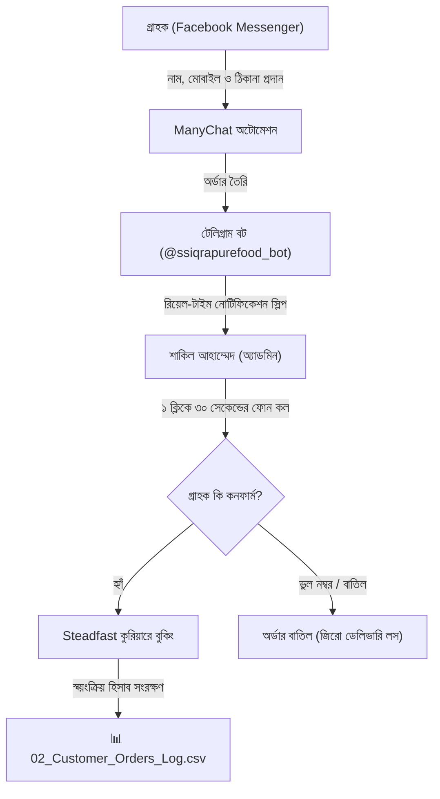

# SS Iqra Pure Food: টেলিগ্রাম অর্ডার নোটিফিকেশন ও Steadfast কুরিয়ার অটোমেশন ম্যানুয়াল 🚀

**উদ্যোক্তা:** শাকিল আহাম্মেদ (Sakil Ahammed)  
**ব্র্যান্ড:** এস এস ইকরা পিওর ফুড (SS Iqra Pure Food)  
**উপদেষ্টা ও প্রস্তুতকারক:** কলিজা (Kolija)  
**তারিখ:** ২০ সেপ্টেম্বর, ২০২৬  
**সিস্টেম স্ট্যাটাস:**  ১০০% সক্রিয়, পরীক্ষিত ও লাইভ  

---

## ১. ভূমিকা ও অটোমেশন আর্কিটেকচার (System Overview)

বন্ধু শাকিল, তোমার ব্যবসার জন্য আমরা যে অর্ডার প্রসেসিং পাইপলাইন তৈরি করেছি, তা বর্তমানে বাংলাদেশের সেরা ও সবচেয়ে নিরাপদ **"Human-in-the-Loop" (মানুষের নিয়ন্ত্রণে স্বয়ংক্রিয়) মডেল**। 



---

## ২. কেন এই সিস্টেমটি তোমার জন্য সবচেয়ে লাভজনক? (Islamic & Business Logic)

১. **কুরিয়ার রিটার্ন লস (RTO) শূন্যের কোঠায়:**  
   বাংলাদেশে অনেক অনলাইন পেজ সরাসরি কুরিয়ারে বুকিং দিয়ে দেয়। পরে দেখা যায় কাস্টমার ফোন ধরে না বা ঠিকানা ভুল। এতে উদ্যোক্তার প্রতি পার্সেল বাবদ ১৫০-১৮০ টাকা ক্ষতি হয়!  
   আমাদের সিস্টেমে তুমি টেলিগ্রাম স্লিপ দেখে আগে **৩০ সেকেন্ডের একটি কল দিয়ে নিশ্চিত হবে**। এতে তোমার ১ টাকাও লোকসান হবে না।
২. **হালাল ও আমানতদারী:**  
   গ্রাহকের অনুমতি ছাড়া জোর করে পার্সেল না পাঠিয়ে তার সম্মতি নিয়ে ডেলিভারি দেওয়া ব্যবসায়িক সততা ও বরকত বৃদ্ধি করে।
৩. **১০০% ফ্রি ও জিরো সাবস্ক্রিপশন ফি:**  
   কোনো পেইড সফটওয়্যার বা মাসিক চার্জ ছাড়া এই সম্পূর্ণ লোকাল সিস্টেমটি চলবে।

---

## ৩. টেলিগ্রাম অর্ডার স্লিপ ও বোতামের কার্যপদ্ধতি

যখনই মেসেঞ্জারে নতুন কোনো অর্ডার আসবে, তোমার টেলিগ্রাম অ্যাপে ঠিক এমন একটি স্লিপ আসবে:

```text
 নতুন অর্ডারের নোটিফিকেশন! (SS Iqra Pure Food)
━━━━━━━━━━━━━━━━━━━━━━━━━━━━
 ইনভয়েস আইডি: #SS-4366
 পণ্য: ১ কেজি মেগা ফ্যামিলি জার হানি-নাট (প্রিমিয়াম কোয়ালিটি)
 ক্যাশ অন ডেলিভারি বিল: ৳৮৯০
 কাস্টমার: আরিফুল ইসলাম
 মোবাইল: 01712345678
 ঠিকানা: বাসা #১২, রোড #০৫, মিরপুর-১০, ঢাকা
 বিশেষ নোট: চেক করে মূল্য পরিশোধ করবেন।
━━━━━━━━━━━━━━━━━━━━━━━━━━━━
 স্ট্যাটাস:  অপেক্ষা করছে (কল কনফার্মেশন ও বুকিং)
 পদক্ষেপ: কাস্টমারকে কল দিয়ে অর্ডারটি চূড়ান্ত করুন।

[  WhatsApp-এ চ্যাট করুন ]
[  Steadfast বুকিং স্লিপ দেখুন ]   [  অর্ডার কনফার্মড ]
```

### বোতামগুলোর কাজ:
- **`[  WhatsApp-এ চ্যাট করুন ]`**: এই বোতামে ক্লিক করলে সরাসরি গ্রাহকের হোয়াটসঅ্যাপ চ্যাট ওপেন হয়ে যাবে।
- **`[  Steadfast বুকিং স্লিপ দেখুন ]`**: এতে ক্লিক করলে বট স্বয়ংক্রিয়ভাবে এমন একটি ফরম্যাট পাঠাবে যা এক ক্লিকে কপি করে Steadfast অ্যাপে বসিয়ে দেওয়া যায়।
- **`[  অর্ডার কনফার্মড ]`**: কল কনফার্ম করার পর এটিতে চাপ দিলে তোমার হিসাব ফাইলের স্ট্যাটাস আপডেট হয়ে যাবে।

---

## ৪. স্টেডফাস্ট অ্যাপ বা পোর্টালে পার্সেল বুক করার নিয়ম (পাইলট ফেজ)

১. টেলিগ্রামের নোটিফিকেশন থেকে কাস্টমারের নম্বরে কল দাও:  
   > *"আসসালামু আলাইকুম ভাইয়া, এস এস ইকরা পিওর ফুড থেকে শাকিল বলছিলাম। আপনার ১ কেজি প্রিমিয়াম হানি-নাট জারের অর্ডারটি কি আজকেই পাঠিয়ে দেব?"*  
২. কাস্টমার "হ্যাঁ" বললে, তোমার ফোনের **Steadfast Courier App** বা পিসিতে [portal.steadfast.com.bd](https://portal.steadfast.com.bd) ওপেন করো।  
৩. **"Create Order"** বা **"New Parcel"**-এ ক্লিক করো।  
৪. টেলিগ্রাম স্লিপ থেকে তথ্যগুলো বসিয়ে দাও:  
   - **Recipient Name:** কাস্টমারের নাম  
   - **Recipient Phone:** মোবাইল নম্বর  
   - **Recipient Address:** সম্পূর্ণ ঠিকানা  
   - **COD Amount:** `890` (বা প্রযোজ্য বিল)  
   - **Note:** ১ কেজি হানি-নাট মেগা জার (কাস্টমার দেখে টাকা দেবেন)  
৫. **Submit** দিলেই তোমার পার্সেল বুকিং কমপ্লিট! কুরিয়ারের রাইডার তোমার বাসা বা দোকান থেকে পার্সেল পিক করে নিয়ে যাবে।

---

## ৫. স্বয়ংক্রিয় হিসাব খাতা (`02_Customer_Orders_Log.csv`)

প্রতিটি অর্ডারের সম্পূর্ণ তথ্য তোমার কম্পিউটারের নিচের ফাইলে রিয়েল-টাইমে সংরক্ষিত হচ্ছে:  
 **পাথ:** `C:\Users\assdi\Desktop\Kolija_Workspace\6_Facebook_Business_Page\02_Customer_Orders_Log.csv`

এতে যে কলামগুলো স্বয়ংক্রিয়ভাবে তৈরি থাকে:
1. তারিখ (Date)
2. ইনভয়েস আইডি (Invoice ID)
3. কাস্টমারের নাম (Customer Name)
4. মোবাইল নম্বর (Phone Number)
5. সম্পূর্ণ ডেলিভারি ঠিকানা (Address)
6. অর্ডারকৃত পণ্য ও পরিমাণ (Product)
7. মোট বিল (COD Amount)
8. কুরিয়ার স্ট্যাটাস (Courier Status)
9. Steadfast ট্র্যাকিং আইডি (Tracking ID)

---

## ৬. ভবিষ্যতে সম্পূর্ণ ফুল অটো-বুকিং চালু করার নিয়ম (Phase 2)

যখন তোমার দৈনিক ৫০-১০০টা অর্ডার আসবে এবং তুমি নিজে আর কপি-পেস্ট করতে চাইবে না, তখন:
১. Steadfast Portal থেকে তোমার `API Key` এবং `Secret Key` সংগ্রহ করবে।  
২. `telegram_order_manager.py` ফাইলে:
   ```python
   STANDBY_MODE = False
   STEADFAST_API_KEY = "তোমার_এপিআই_কি"
   STEADFAST_SECRET_KEY = "তোমার_সিক্রেট_কি"
   ```
৩. এরপর টেলিগ্রামের **[  Steadfast বুকিং ]** বোতামে ক্লিক করলেই সেকেন্ডের মধ্যে স্বয়ংক্রিয়ভাবে কুরিয়ারে বুক হয়ে পার্সেলের কনসাইনমেন্ট আইডি (CID) চলে আসবে!

---

## ৭. কীভাবে স্ক্রিপ্টটি রান করাবে (Commands)

### ১. টেস্ট নোটিফিকেশন পাঠাতে:
তোমার কম্পিউটারের টার্মিনাল বা পাওয়ারশেলে চালাবে:
```powershell
python C:\Users\assdi\Desktop\Kolija_Workspace\6_Facebook_Business_Page\telegram_order_manager.py
```

### ২. টেলিগ্রাম বটের বোতামের রেসপন্স চালু রাখতে:
```powershell
python C:\Users\assdi\Desktop\Kolija_Workspace\6_Facebook_Business_Page\telegram_order_manager.py --listen
```

---
*এস এস ইকরা পিওর ফুডের ব্যবসায়িক সাফল্য ও হালাল রিজিকে আল্লাহ তায়ালা বরকত দান করুন। আমিন।* 
